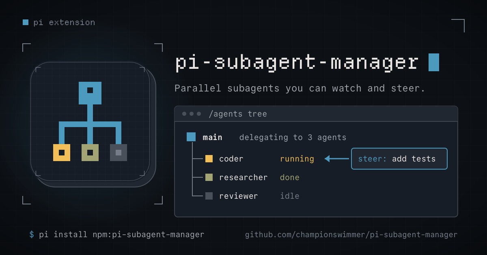

[](https://www.npmjs.com/package/pi-subagent-manager)
[](https://www.npmjs.com/package/pi-subagent-manager)
[](https://github.com/championswimmer/pi-subagent-manager/stargazers)
[](https://github.com/championswimmer/pi-subagent-manager/actions/workflows/tests.yml)
[](https://codecov.io/gh/championswimmer/pi-subagent-manager)

Let pi hand work to helper agents in parallel. Watch what they're doing, give them more direction, or pick up a finished agent's conversation.

## Install

```bash
pi install npm:pi-subagent-manager
```

Requires pi **0.99.2+**.

## Why use it

- Hand independent jobs to helper agents that run in parallel.
- Watch any agent live in a nested agent tree.
- Steer a running agent with more direction, or resume it after it finishes.
- Choose `fork:` to share your conversation or `fresh:` to start clean.
- Six bundled roles, with per-role model, tools, and instructions you can change, plus custom agents.

## How to use


A real Pi session with a customized footer and Nerd Font: parallel work, nested delegation, watching, and steering. [Recording details](https://github.com/championswimmer/pi-subagent-manager/blob/main/docs/demo.md) (37 seconds; pauses shortened).

### Start using it

Ask pi to delegate in plain language:

> Have a reviewer check my last commit while a researcher looks up how this repo handles retries.

Or start an agent yourself:

```text
/agents fork:coder fix the failing auth test
```

`fork:` includes your current conversation. Use `fresh:` instead for a task that needs no conversation history.

The **Agents** widget above the input shows what's running. Open `/agents tree`, select an agent, and press **Enter** to watch it. Type in the **Steer** input to give it more direction or resume it after it finishes. Results also return to the main agent.

### Bundled agents

| Agent        | Use it for                              |
| ------------ | --------------------------------------- |
| `architect`  | Plans, tradeoffs, coordinating helpers  |
| `coder`      | Implementation and debugging            |
| `researcher` | Codebase and web research               |
| `reviewer`   | Finding correctness and security issues |
| `tasker`     | Small jobs and quick lookups            |
| `writer`     | Drafting and editing prose              |

They use your current model until you configure preferences. Open `/agents types` to change a role's model, tools, or instructions, or [add your own agent](https://github.com/championswimmer/pi-subagent-manager/blob/main/docs/custom-agents.md).

## Settings and safety

Open `/agents` to change delegation mode, limits, and display settings; save with **Ctrl+S**. Experimental options are marked **[labs]** in their help. **[lab] Subagent extensions** opens a per-extension chooser (Space/Enter toggles, Esc returns); **Save and apply** persists the selection for new subagent sessions. It lists auto-discovered `.ts`/`.js` files and subdirectory entry points in Pi’s agent-dir `extensions/` (honoring `PI_CODING_AGENT_DIR`), trusted project `.pi/extensions/`, and configured/package files—not CLI-only/inline/built-in extensions; see [limitations](https://github.com/championswimmer/pi-subagent-manager/blob/main/docs/subagent-extension-limitations.md).

Agents share your working directory and OS permissions: **tool policies are not a sandbox**. Don't run multiple subagent extensions together — they clash on `/agents`.

## Documentation

- [Commands and navigation](https://github.com/championswimmer/pi-subagent-manager/blob/main/docs/tools-and-ui.md#commands) — watching, steering, stopping, and keyboard shortcuts
- [Settings](https://github.com/championswimmer/pi-subagent-manager/blob/main/docs/settings.md) — models, tool access, limits, and experimental features
- [Custom agents](https://github.com/championswimmer/pi-subagent-manager/blob/main/docs/custom-agents.md) · [Bundled roles](https://github.com/championswimmer/pi-subagent-manager/blob/main/docs/default-agents.md)
- [Importing agents](https://github.com/championswimmer/pi-subagent-manager/blob/main/docs/importing-agents.md) from other subagent packages
- [Development](https://github.com/championswimmer/pi-subagent-manager/blob/main/docs/development.md) · [Changelog](CHANGELOG.md)

[MIT license](LICENSE)

## Check out my other Pi extensions

- [](https://github.com/championswimmer/pi-cache-graph) — Real-time prompt cache hit rates and token metrics.
- [](https://github.com/championswimmer/pi-checklist) — Session task checklist with dependencies and a TUI renderer.
- [](https://github.com/championswimmer/pi-context-decisions) — Selects relevant skills and optionally filters tools for each task.
- [](https://github.com/championswimmer/pi-context-prune) — Prunes verbose tool outputs from context while preserving history.
- [](https://github.com/championswimmer/pi-context-usage) — Dot-grid visualization of context window token usage.
- [](https://github.com/championswimmer/pi-gauge) — Live tokens/sec and TTFT in the status bar.
- [](https://github.com/championswimmer/pi-subagent-manager) — Delegate work to parallel subagents and monitor their progress.
